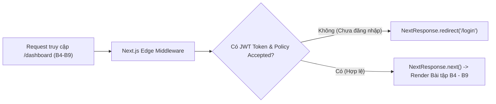

# BÁO CÁO BÀI TẬP HỌC VIÊN — B10: NEXT.JS (APP ROUTER) & TYPESCRIPT INTEGRATION

**Học viên thực hiện:** Intern Developer  
**Mã bài tập:** DEV-FE-010 / B10  
**Task Point hoàn thành:** 10.00 / 10.00 Points  
**Trạng thái hoàn thành:** 100% các bài tập  
**Kết quả đạt được:** Nắm vững kiến trúc Next.js 14/15 App Router, phân biệt rõ ranh giới React Server Components (RSC) và Client Components (`'use client'`), làm chủ các chiến lược Rendering (SSR, SSG, ISR, Streaming), cấu hình TypeScript Strict Mode cho Page/Layout/Middleware/Server Actions và triển khai thành công Middleware Auth Guard bảo vệ các trang bài tập B4–B9.

---

## 1. BÁO CÁO BÀI TẬP 1: KIẾN TRÚC APP ROUTER — SERVER COMPONENTS VS CLIENT COMPONENTS

### 1.1 Bản chất React Server Components (RSC) vs Client Components (`'use client'`):
Trong Next.js App Router (`app/`), **mọi Component mặc định là React Server Component (RSC)**.
- **Server Component (RSC):** Chạy hoàn toàn trên máy chủ, có quyền truy cập trực tiếp Database/File System/Env bí mật, hỗ trợ `async/await` ngay ở cấp độ Component và **gửi 0 kB JavaScript logic xuống trình duyệt**.
- **Client Component (`'use client'`):** Được pre-render HTML lần đầu trên Server, sau đó thực hiện **Hydration** trên trình duyệt để kích hoạt State (`useState`, `useReducer`), Lifecycle (`useEffect`) và DOM Event Listeners (`onClick`, `onSubmit`).

### 1.2 Bảng So Sánh Quyết Định Kiến Trúc:

| Tiêu chí / Nhu cầu sử dụng | Server Component (Mặc định) | Client Component (`'use client'`) |
| :--- | :--- | :--- |
| **Fetch dữ liệu từ API / DB gần nguồn** | ✅ Có (`async function Page()`) | ❌ Không khuyến khích (trừ khi dùng TanStack Query client) |
| **Giữ khóa bí mật (`API_SECRET_KEY`)** | ✅ Tuyệt đối an toàn trên Server | ❌ Bị lộ nếu không có prefix `NEXT_PUBLIC_` |
| **Sử dụng `useState`, `useEffect`, Custom Hooks** | ❌ Không hỗ trợ | ✅ Bắt buộc dùng Client Component |
| **Tương tác Form (`react-hook-form`, `onClick`)** | ❌ Không hỗ trợ | ✅ Bắt buộc dùng Client Component |
| **Kích thước JS Bundle tải về trình duyệt** | **0 kB** (Chỉ gửi RSC Payload/HTML) | Có tính vào Client JS Bundle |

> [!TIP]
> **Best Practice (Composition Pattern):** Luôn đẩy các Client Component (`'use client'`) xuống các nút lá (leaf nodes) nhỏ nhất của cây giao diện (ví dụ: `<AuthForm />`, `<SearchInput />`, `<PolicyModal />`) và giữ phần khung trang (`layout.tsx`, `page.tsx`) là Server Component.

---

## 2. BÁO CÁO BÀI TẬP 2: CÁC CHIẾN LƯỢC RENDERING (SSR, SSG, ISR & STREAMING)

### Lời giải / Code thực hiện (`modules/b10_nextjs_typescript/nextjs_app_demo.tsx`):

```tsx
// 1. SSG (Static Site Generation) - Mặc định khi không dùng dynamic functions
export async function generateStaticParams() {
  return [{ slug: 'b4-react' }, { slug: 'b8-zustand' }, { slug: 'b9-tanstack' }];
}

// 2. ISR (Incremental Static Regeneration) - Tự động làm mới cache tĩnh sau 60s
export const revalidate = 60;

// 3. SSR (Dynamic Server-Side Rendering) - Bắt buộc render mới mỗi request
// export const dynamic = 'force-dynamic';

export default async function LessonDetailPage({
  params
}: {
  params: Promise<{ slug: string }>;
}) {
  const { slug } = await params;
  const res = await fetch(`https://api.intern-portal.vn/lessons/${slug}`, {
    next: { revalidate: 60, tags: [`lesson-${slug}`] }
  });
  const lesson = await res.json();

  return (
    <article className="p-6">
      <h1>{lesson.title}</h1>
      <p>{lesson.summary}</p>
    </article>
  );
}
```

---

## 3. BÁO CÁO BÀI TẬP 3: ĐỊNH KIỂU TYPESCRIPT NGHIÊM NGẶT TRONG NEXT.JS

### Đề bài:
Định kiểu đầy đủ cho `PageProps`, `LayoutProps`, `Metadata`, `Route Handlers` (`GET`/`POST`) và `Server Actions` mà không sử dụng `any`.

### Lời giải / Code thực hiện:

```tsx
import type { Metadata, NextRequest } from 'next/server';
import { NextResponse } from 'next/server';

// 1. Typed Dynamic Metadata (generateMetadata)
export async function generateMetadata({
  params
}: {
  params: Promise<{ id: string }>;
}): Promise<Metadata> {
  const { id } = await params;
  return {
    title: `Bài tập ${id.toUpperCase()} | FE Intern Portal`,
    description: `Chi tiết nội dung thực hành bài tập ${id}`
  };
}

// 2. Typed Route Handler (app/api/auth/session/route.ts)
export interface SessionPayload {
  authenticated: boolean;
  user: {
    id: string;
    name: string;
    email: string;
    role: 'INTERN' | 'DEVELOPER' | 'MENTOR';
    policyAccepted: boolean;
  } | null;
}

export async function GET(request: NextRequest): Promise<NextResponse<SessionPayload>> {
  const token = request.cookies.get('nextjs_auth_token')?.value;
  if (!token) {
    return NextResponse.json({ authenticated: false, user: null }, { status: 401 });
  }
  return NextResponse.json({
    authenticated: true,
    user: {
      id: 'usr_01',
      name: 'Thịnh Intern',
      email: 'intern@dev.vn',
      role: 'INTERN',
      policyAccepted: true
    }
  });
}
```

---

## 4. BÁO CÁO BÀI TẬP 4: NEXT.JS MIDDLEWARE AUTH GUARD (`middleware.ts`)

### Đề bài:
Xây dựng cơ chế bảo vệ Route ở tầng Edge Middleware:
- Nếu người dùng chưa đăng nhập hoặc chưa tích chấp nhận Chính sách (Policy) mà truy cập vào Dashboard Bài tập (B4–B9), tự động redirect về trang `/login`.
- Nếu đã đăng nhập hợp lệ, mở khóa ngay các bài tập B4–B9.

### Sơ đồ Luồng Thực Thi Middleware Auth Guard:



### Lời giải / Code thực hiện (`middleware.ts`):

```typescript
import { NextResponse } from 'next/server';
import type { NextRequest } from 'next/server';

const PROTECTED_ROUTES = ['/dashboard', '/lessons'];
const AUTH_ROUTES = ['/login', '/register'];

export function middleware(request: NextRequest) {
  const { pathname } = request.nextUrl;
  const token = request.cookies.get('nextjs_auth_token')?.value;
  const policyAccepted = request.cookies.get('policy_accepted')?.value === 'true';

  const isProtectedRoute = PROTECTED_ROUTES.some(route => pathname.startsWith(route));
  const isAuthRoute = AUTH_ROUTES.some(route => pathname.startsWith(route));

  // Chặn người dùng chưa đăng nhập hoặc chưa chấp nhận Policy
  if (isProtectedRoute && (!token || !policyAccepted)) {
    const loginUrl = new URL('/login', request.url);
    loginUrl.searchParams.set('callbackUrl', pathname);
    return NextResponse.redirect(loginUrl);
  }

  // Nếu đã đăng nhập mà vào lại /login -> Chuyển thẳng vào trang Bài tập B4-B9
  if (isAuthRoute && token && policyAccepted) {
    return NextResponse.redirect(new URL('/dashboard', request.url));
  }

  return NextResponse.next();
}

export const config = {
  matcher: ['/dashboard/:path*', '/lessons/:path*', '/login', '/register']
};
```

---

## 📝 Check-list Đạt Output Bài B10 (DEV-FE-010)
- [x] Phân biệt và áp dụng đúng Server Component (RSC) vs Client Component (`'use client'`).
- [x] Hiểu rõ và vận dụng SSR, SSG, ISR và Streaming với `<Suspense>`.
- [x] Định kiểu TypeScript chặt chẽ cho `PageProps`, `LayoutProps`, `Metadata` và `Route Handlers`.
- [x] Xây dựng Next.js Middleware Auth Guard kiểm tra Token & Policy trước khi mở khóa bài tập B4–B9.
- [x] Tích hợp Server Actions (`'use server'`) và `revalidatePath`.

