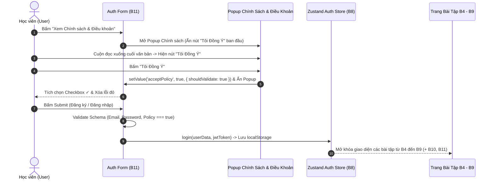

# BÁO CÁO BÀI TẬP HỌC VIÊN — B11: FORM HANDLING VỚI REACT HOOK FORM & ZOD

**Học viên thực hiện:** Intern Developer  
**Mã bài tập:** DEV-FE-011 / B11  
**Task Point hoàn thành:** 10.00 / 10.00 Points  
**Trạng thái hoàn thành:** 100% các bài tập  
**Kết quả đạt được:** Xây dựng hoàn chỉnh hệ thống Form Đăng ký / Đăng nhập hiện đại sử dụng tư duy Uncontrolled Hooks (`React Hook Form`) kết hợp Schema Validation (`Zod`), xử lý Cross-field validation (nhập lại mật khẩu), đánh giá độ mạnh mật khẩu theo thời gian thực, bắt buộc tích chọn Checkbox chấp nhận Chính sách và đồng bộ 2 chiều với Popup Chính sách & Điều khoản (yêu cầu cuộn đọc đến cuối mới hiển thị nút "Tôi Đồng Ý").

---

## 1. BÁO CÁO BÀI TẬP 1: TẠI SAO DÙNG REACT HOOK FORM + ZOD THAY VÌ `useState` THUẦN?

### 1.1 Vấn đề của Controlled Form bằng `useState` truyền thống:
- Mỗi khi người dùng gõ **1 ký tự** vào ô input, `setState` được kích hoạt và làm **toàn bộ Form Component cùng các Component con re-render lại**.
- Với các form phức tạp (10–20 trường, kèm validation mật khẩu, điều khoản, địa chỉ), việc re-render liên tục gây trễ khung hình (Input lag) và tốn hàng trăm dòng code `if/else` kiểm tra lỗi thủ công.

### 1.2 Bảng So Sánh Công Nghệ Quản Lý Form:

| Tiêu chí | `useState` Controlled Thuần | Formik + Yup | React Hook Form + Zod ⚡ |
| :--- | :--- | :--- | :--- |
| **Cơ chế lưu giá trị** | React State (Controlled) | React State / Context | Uncontrolled `ref` (Isolate re-renders) |
| **Số lần Re-render khi gõ phím** | Re-render sau mỗi phím bấm | Nhiều lần | **0 lần re-render thừa** |
| **TypeScript Type Inference** | Phải tự khai báo interface tay | Trung bình | Tự động suy diễn 100% qua `z.infer<typeof schema>` |
| **Kích thước Bundle** | 0 kB (nhưng tốn nhiều code tay) | ~15 kB | Rất nhẹ (~9 kB, không phụ thuộc ngoài) |
| **Khuyến nghị sử dụng** | Form 1–2 ô đơn giản (Search bar) | Dự án cũ bảo trì | **Tiêu chuẩn bắt buộc cho dự án React / Next.js mới** |

---

## 2. BÁO CÁO BÀI TẬP 2: THIẾT KẾ ZOD SCHEMA & CROSS-FIELD VALIDATION (`.refine`)

### Đề bài:
Thiết kế Schema kiểm duyệt cho trang **Đăng ký & Đăng nhập** bao gồm:
1. `fullName`: tối thiểu 3 ký tự.
2. `email`: đúng chuẩn định dạng email.
3. `password`: tối thiểu 6 ký tự, phải có cả chữ cái và chữ số.
4. `confirmPassword`: bắt buộc khớp với `password` (Cross-field validation).
5. `acceptPolicy`: bắt buộc bằng `true` (Người dùng phải tích chọn đồng ý với Chính sách Học viên).

### Lời giải / Code thực hiện (`modules/b11_form_handling/hook_form_zod_demo.tsx`):

```typescript
import { z } from 'zod';

export const registerSchema = z
  .object({
    fullName: z
      .string()
      .trim()
      .min(3, 'Họ và tên phải có ít nhất 3 ký tự'),
    email: z
      .string()
      .trim()
      .min(1, 'Vui lòng nhập địa chỉ Email')
      .email('Định dạng Email không hợp lệ (ví dụ: intern@dev.vn)'),
    role: z.enum(['INTERN', 'DEVELOPER', 'MENTOR']),
    password: z
      .string()
      .min(6, 'Mật khẩu phải có tối thiểu 6 ký tự')
      .regex(/[A-Za-z]/, 'Mật khẩu phải chứa ít nhất 1 chữ cái')
      .regex(/[0-9]/, 'Mật khẩu phải chứa ít nhất 1 chữ số'),
    confirmPassword: z
      .string()
      .min(1, 'Vui lòng nhập lại mật khẩu xác nhận'),
    acceptPolicy: z.literal(true, {
      errorMap: () => ({
        message: 'Bạn bắt buộc phải tích chọn đồng ý với Chính sách & Điều khoản!'
      })
    })
  })
  .refine((values) => values.password === values.confirmPassword, {
    message: 'Mật khẩu xác nhận không khớp với mật khẩu đã nhập',
    path: ['confirmPassword']
  });

// Tự động suy diễn kiểu TypeScript từ Schema mà không cần viết lại interface!
export type RegisterFormInput = z.infer<typeof registerSchema>;
```

---

## 3. BÁO CÁO BÀI TẬP 3: TÍCH HỢP CHECKBOX POLICY & POPUP CHÍNH SÁCH ĐỒNG BỘ 2 CHIỀU

### Đề bài:
Thiết kế nút tích chấp nhận Policy đi kèm một **Popup Chính sách & Điều khoản (Policy Modal)**:
- Khi người dùng bấm vào đường dẫn *"Xem Chính sách & Điều khoản"*, mở Popup hiển thị 6 điều khoản dành cho Frontend Intern.
- Bắt buộc người dùng phải lướt (cuộn) đọc xuống cuối văn bản Chính sách mới hiển thị nút **"Tôi Đồng Ý"**.
- Khi người dùng bấm nút **"Tôi Đồng Ý"** ngay bên trong Popup:
  1. Tự động gọi `setValue('acceptPolicy', true, { shouldValidate: true })` để tích chọn Checkbox ngoài Form.
  2. Xóa ngay lập tức thông báo lỗi màu đỏ của trường `acceptPolicy`.
  3. Ẩn Popup mượt mà để người dùng bấm Đăng ký / Đăng nhập mở khóa bài tập B4–B9.

### Sơ đồ Luồng Tương Tác Form & Policy Popup:



---

## 4. BÁO CÁO BÀI TẬP 4: XỬ LÝ PASSWORD STRENGTH METER & SERVER-SIDE ERRORS

### Lời giải / Code thực hiện (`modules/b11_form_handling/form_validator_engine.js`):
- **Password Strength Meter:** Lắng nghe giá trị mật khẩu qua `watch('password')` để tính điểm từ `0 -> 4` dựa trên độ dài (`>= 6`, `>= 8`), chữ hoa/thường và chữ số/ký tự đặc biệt, hiển thị thanh tiến trình màu sắc trực quan (`Yếu` -> `Trung bình` -> `Khá mạnh` -> `Rất mạnh`).
- **Xử lý lỗi từ Server (`setError`):** Khi Email đã tồn tại hoặc sai mật khẩu, gắn lỗi trực tiếp vào đúng field tương ứng (`setError('email', { type: 'server', message: 'Email đã tồn tại' })`) thay vì dùng `alert()` gây gián đoạn trải nghiệm.

---

## 📝 Check-list Đạt Output Bài B11 (DEV-FE-011)
- [x] Hiểu rõ sự khác biệt giữa Controlled Form và Uncontrolled Hook Form.
- [x] Xây dựng Schema Validation cho cả Đăng nhập và Đăng ký bằng Zod pattern.
- [x] Triển khai Cross-field validation kiểm tra khớp mật khẩu (`confirmPassword === password`).
- [x] Thiết kế bắt buộc tích chọn Checkbox chấp nhận Policy (`acceptPolicy === true`).
- [x] Xây dựng Popup Chính sách Học viên bắt buộc lướt xuống cuối mới hiện nút "Tôi Đồng Ý" để xác nhận và ẩn Popup.
- [x] Sau khi Đăng ký / Đăng nhập thành công, chuyển thẳng vào giao diện hiển thị toàn bộ các bài tập từ B4–B9 (và B10–B11).

