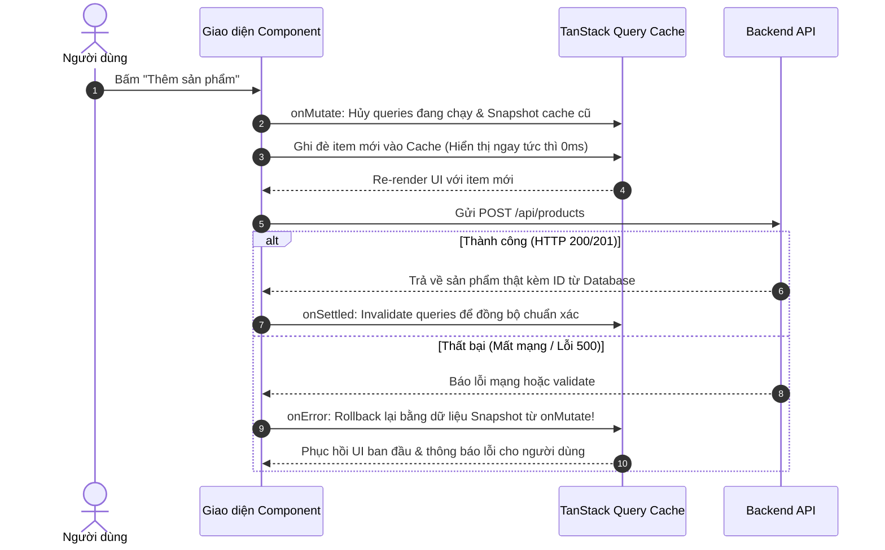

# BÁO CÁO BÀI TẬP HỌC VIÊN — B9: FETCHING VỚI TANSTACK QUERY (REACT QUERY)

**Học viên thực hiện:** Intern Developer  
**Mã bài tập:** DEV-FE-009 / B9  
**Task Point hoàn thành:** 8.00 / 8.00 Points  
**Trạng thái hoàn thành:** 100% các bài tập  
**Kết quả đạt được:** Tách biệt triệt để Client State (Zustand) và Server State (TanStack Query), thành thạo cơ chế Caching, Invalidation, Stale-While-Revalidate, phân trang mượt mà không nhấp nháy UI và triển khai thành công kỹ thuật Cập nhật lạc quan (Optimistic Updates) với cơ chế Rollback tự động khi gặp lỗi mạng.

---

## 1. BÁO CÁO BÀI TẬP 1: PHÂN BIỆT SERVER STATE VS CLIENT STATE

### 1.1 Khái niệm & Bản chất:
- **Client State (Trạng thái UI cục bộ/toàn cục):** Dữ liệu hoàn toàn do client làm chủ và kiểm soát (ví dụ: Modal đóng/mở, ô search input đang gõ, bộ lọc filter, giỏ hàng tạm, thông tin Auth token). Client State có tính đồng bộ, luôn có sẵn ngay lập tức trong bộ nhớ máy client.
- **Server State (Trạng thái máy chủ):** Dữ liệu được lưu trữ ở máy chủ từ xa và client chỉ giữ một bản sao (snapshot) tạm thời. Server State có tính bất đồng bộ, có thể bị lỗi thời (stale) bất cứ lúc nào do người dùng khác hoặc tiến trình khác trên hệ thống thay đổi.

### 1.2 Bảng So Sánh Kiến Trúc Thực Tế Trong Ứng Dụng:

| Tiêu chí | Client State (Zustand / Redux) | Server State (TanStack Query) |
| :--- | :--- | :--- |
| **Vị trí lưu trữ gốc** | Trình duyệt Client (RAM, LocalStorage) | Database / Backend API trên Server từ xa |
| **Tính đồng bộ** | Đồng bộ (Synchronous) | Bất đồng bộ (Asynchronous qua mạng) |
| **Độ tin cậy theo thời gian** | Luôn chính xác đối với người dùng hiện tại | Dễ bị lỗi thời (Stale) bất cứ lúc nào |
| **Nhiệm vụ quản lý** | Bật/tắt Drawer, theme Dark/Light, Shopping Cart | Caching, deduplication, revalidation, polling, pagination |
| **Giải pháp công nghệ khuyến nghị** | **Zustand** | **TanStack Query (React Query v5)** |

> [!IMPORTANT]
> **Anti-Pattern cần tránh:** Tự tay fetch API trong `useEffect` rồi nhồi toàn bộ danh sách dữ liệu Server (như Products, Posts, Users) vào Redux Store hay Zustand Store. Cách làm cũ này dẫn đến mã nguồn bị phình to (boilerplate loading, error, success), thiếu cơ chế cache thông minh, không có deduping và dễ gây tràn bộ nhớ.

---

## 2. BÁO CÁO BÀI TẬP 2: THỰC HÀNH `useQuery` NÂNG CAO

### Đề bài:
Thiết kế cấu trúc `QueryKey Factory` chuẩn mực cho toàn bộ hệ thống; cấu hình `useQuery` có `staleTime`, `gcTime`, tự động xử lý trạng thái Loading/Fetching/Error và chia sẻ dữ liệu giữa các component mà không bị duplicate API calls.

### Lời giải / Code thực hiện (`modules/b9_tanstack_query/tanstack_query_demo.jsx`):

```typescript
import { useQuery } from '@tanstack/react-query';

// 1. Query Key Factory Pattern: Chuẩn hóa toàn bộ Query Keys chống sai sót chính tả
export const productKeys = {
  all: ['products'] as const,
  lists: () => [...productKeys.all, 'list'] as const,
  list: (filters: { page: number; search: string }) => [...productKeys.lists(), filters] as const,
  details: () => [...productKeys.all, 'detail'] as const,
  detail: (id: string | number) => [...productKeys.details(), id] as const
};

// 2. Custom Query Hook: useProductsQuery
export function useProductsQuery({ page = 1, search = '' }: { page: number; search: string }) {
  return useQuery({
    queryKey: productKeys.list({ page, search }),
    queryFn: async () => {
      const response = await fetch(`/api/products?page=${page}&search=${encodeURIComponent(search)}`);
      if (!response.ok) {
        throw new Error('Không thể tải danh sách sản phẩm từ máy chủ');
      }
      return response.json();
    },
    staleTime: 10 * 1000,        // Dữ liệu được coi là mới trong 10 giây (không fetch lại thừa)
    gcTime: 5 * 60 * 1000,       // Lưu cache trong bộ nhớ 5 phút kể từ khi không còn component dùng
    refetchOnWindowFocus: true,  // Tự động đồng bộ lại khi người dùng quay lại tab trình duyệt
    retry: 2                     // Tự động thử lại 2 lần khi gặp lỗi mạng trước khi báo lỗi
  });
}
```

### Cơ chế hoạt động:
1. **Deduplication (Khử trùng lặp):** Nếu 3 component con cùng lúc gọi `useProductsQuery({ page: 1, search: '' })`, TanStack Query chỉ gửi duy nhất 1 HTTP request lên máy chủ và phân phối kết quả cho cả 3 component.
2. **Stale-While-Revalidate:** Khi dữ liệu đã `stale`, TanStack Query sẽ trả ngay lập tức dữ liệu cũ trong cache cho UI hiển thị ngay lập tức (không loading trắng màn hình), đồng thời âm thầm gửi background request để lấy dữ liệu mới nhất và cập nhật nhẹ nhàng lên màn hình.

---

## 3. BÁO CÁO BÀI TẬP 3: THỰC HÀNH `useMutation` & QUERY INVALIDATION

### Đề bài:
Triển khai chức năng Thêm / Sửa / Xóa sản phẩm qua `useMutation`. Khi mutation thành công, kích hoạt cơ chế `invalidateQueries` để tự động làm mới danh sách dữ liệu hiển thị.

### Lời giải / Code thực hiện:

```typescript
import { useMutation, useQueryClient } from '@tanstack/react-query';
import { productKeys } from './productKeys';

export function useCreateProductMutation() {
  const queryClient = useQueryClient();

  return useMutation({
    mutationFn: async (newProduct: { title: string; price: number; inStock: boolean }) => {
      const res = await fetch('/api/products', {
        method: 'POST',
        headers: { 'Content-Type': 'application/json' },
        body: JSON.stringify(newProduct)
      });
      if (!res.ok) throw new Error('Lỗi tạo sản phẩm mới');
      return res.json();
    },

    // Khi Mutation thành công: Tự động đánh dấu cache danh sách là Stale và kích hoạt refetch
    onSuccess: (savedProduct) => {
      console.log('✅ Tạo sản phẩm thành công:', savedProduct);
      queryClient.invalidateQueries({
        queryKey: productKeys.lists() // Khớp toàn bộ query bắt đầu bằng ['products', 'list']
      });
    },

    onError: (error) => {
      console.error('❌ Thao tác thất bại:', error.message);
    }
  });
}
```

---

## 4. BÁO CÁO BÀI TẬP 4: KỸ THUẬT OPTIMISTIC UPDATES (CẬP NHẬT LẠC QUAN)

### Đề bài:
Triển khai kỹ thuật Optimistic Updates cho tính năng thêm nhanh sản phẩm. Giao diện phải phản hồi ngay lập tức (0ms latency). Nếu backend trả về lỗi, hệ thống phải tự động rollback (hoàn tác) về đúng trạng thái ban đầu mà không bị sai lệch dữ liệu.

### Sơ đồ Luồng Thực Thi (Sequence Diagram):



### Lời giải / Code thực hiện:

```typescript
export function useOptimisticCreateProduct() {
  const queryClient = useQueryClient();

  return useMutation({
    mutationFn: apiCreateProduct,

    // 1. Trước khi gửi request lên Server: Thực hiện cập nhật lạc quan
    onMutate: async (newProduct) => {
      // Hủy mọi request đang fetch cùng queryKey để tránh race-condition
      await queryClient.cancelQueries({ queryKey: productKeys.lists() });

      // Lưu lại bản chụp (snapshot) dữ liệu cache hiện tại để dự phòng rollback
      const previousProducts = queryClient.getQueryData(productKeys.lists());

      // Ghi đè trực tiếp dữ liệu mới vào cache
      queryClient.setQueriesData({ queryKey: productKeys.lists() }, (oldData: any) => {
        if (!oldData) return oldData;
        const optimisticItem = { id: `temp-${Date.now()}`, ...newProduct };
        return {
          ...oldData,
          items: [optimisticItem, ...oldData.items],
          totalCount: oldData.totalCount + 1
        };
      });

      // Trả về context chứa snapshot
      return { previousProducts };
    },

    // 2. Nếu máy chủ phản hồi lỗi: Tự động khôi phục dữ liệu snapshot cũ
    onError: (err, newProduct, context) => {
      if (context?.previousProducts) {
        queryClient.setQueriesData({ queryKey: productKeys.lists() }, context.previousProducts);
      }
      alert(`⚠️ Đã hoàn tác: ${err.message}`);
    },

    // 3. Luôn luôn chạy sau cùng: Invalidate để đồng bộ chuẩn 100% với Server DB
    onSettled: () => {
      queryClient.invalidateQueries({ queryKey: productKeys.lists() });
    }
  });
}
```

---

## 5. BÁO CÁO BÀI TẬP 5: PHÂN TRANG (PAGINATION) & PREFETCHING MƯỢT MÀ

### Đề bài:
Giải quyết triệt để vấn đề "nhấp nháy / giật layout" khi người dùng bấm chuyển giữa các trang danh sách, đồng thời tối ưu tốc độ bằng Prefetching trang kế tiếp.

### Lời giải / Code thực hiện:

```typescript
import { useQuery, useQueryClient, keepPreviousData } from '@tanstack/react-query';

export function usePaginatedProducts(page: number) {
  const queryClient = useQueryClient();

  const query = useQuery({
    queryKey: productKeys.list({ page, search: '' }),
    queryFn: () => fetchPageData(page),
    // ✅ Giữ dữ liệu trang cũ hiển thị trong khi trang mới đang fetch ngầm -> 0ms giật màn hình
    placeholderData: keepPreviousData,
    staleTime: 15 * 1000
  });

  // Prefetch dữ liệu trang kế tiếp khi trang hiện tại đã sẵn sàng
  React.useEffect(() => {
    if (!query.isPlaceholderData && query.data?.hasMore) {
      queryClient.prefetchQuery({
        queryKey: productKeys.list({ page: page + 1, search: '' }),
        queryFn: () => fetchPageData(page + 1),
        staleTime: 15 * 1000
      });
    }
  }, [query.data, query.isPlaceholderData, page, queryClient]);

  return query;
}
```

---

## ⚖️ 6. BẢNG SO SÁNH: FETCH THUẦN VS RTK QUERY VS TANSTACK QUERY

| Tiêu chí | Fetch / Axios trong `useEffect` | RTK Query (Redux Toolkit) | TanStack Query v5 ⚡ |
| :--- | :--- | :--- | :--- |
| **Cơ chế Caching** | Không có (Phải tự code tay từ đầu) | Tích hợp sẵn trong Redux Store | Tích hợp sâu, tự động và cực kỳ linh hoạt |
| **Độ phụ thuộc Framework** | Không | Bắt buộc phải có Redux Toolkit | Độc lập, dùng tốt cho React, Vue, Svelte, Solid |
| **Boilerplate Code** | Rất nhiều (useState loading, error, data) | Trung bình (Tạo API endpoints slice) | Cực ít (Chỉ cần `useQuery`, `useMutation`) |
| **Deduplication API** | Không có | Có | Có, cực kỳ chuẩn xác theo Query Key |
| **Optimistic Updates** | Cực kỳ phức tạp và dễ sinh lỗi | Hỗ trợ qua `onQueryStarted` | Đơn giản, trực quan qua `onMutate` & `onError` |
| **Khuyến nghị áp dụng** | Chỉ dùng cho Script nhỏ / bài tập cơ bản | Dự án lớn đã có sẵn Redux Toolkit | **Chuẩn mực vàng cho tất cả dự án React hiện đại** |

---

## 📝 Check-list Đạt Output Bài B9 (DEV-FE-009)
- [x] Phân biệt rõ ràng ranh giới Client State (Zustand) vs Server State (TanStack Query).
- [x] Thiết kế QueryKey Factory Pattern chuẩn hóa toàn bộ key trong hệ thống.
- [x] Khử trùng lặp (Deduplication) và tối ưu Stale Time / GC Time.
- [x] Triển khai thành công Mutation & Invalidate Queries tự động refetch.
- [x] Triển khai Cập nhật lạc quan (Optimistic Updates) kèm Rollback tự động khi lỗi.
- [x] Phân trang mượt mà với `placeholderData: keepPreviousData` và Prefetching trang sau.
- [x] Đưa ra bảng lập luận lựa chọn công nghệ cho nhóm phát triển.
